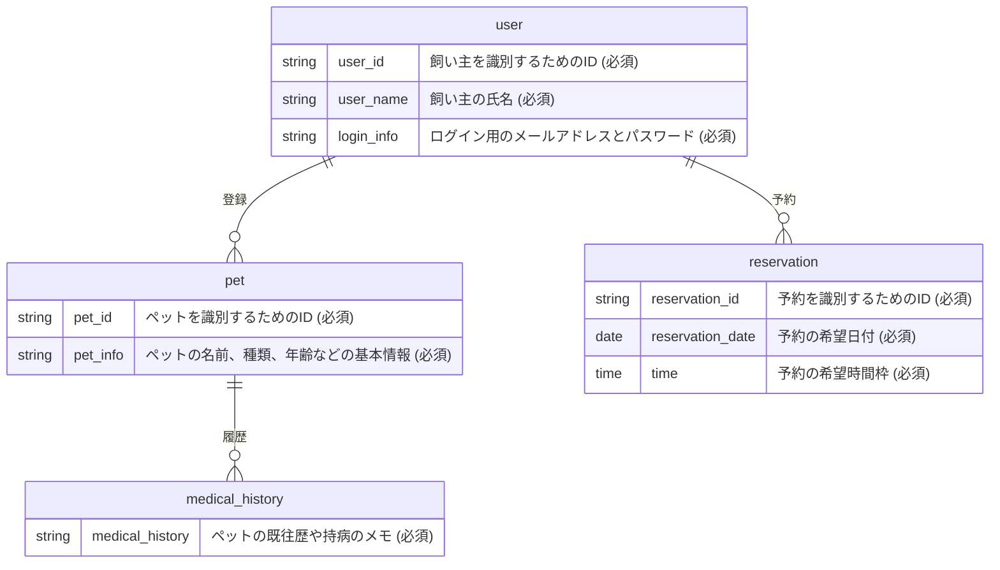

# 🏥 動物病院予約管理アプリ

### 📱 キャッチコピー
簡単に予約でき、待ち時間なく受診できるアプリ

---

## 🔗 アプリケーションのURL
* **本番環境URL:** [ここにあなたのアプリのURLを貼り付けてください]
* **テスト用アカウント:**
  * **メールアドレス:** `test@example.com`
  * **パスワード:** `password123`
  ※ログインが必須なため、審査用のテストアカウントを用意いたしました。

---

## 📝 アプリケーションを開発した背景
飼い主が待ち時間なく受診できるよう手軽に予約ができ、満足度を上げるために開発しました。

* **ユーザーゴール（飼い主）：** 飼い主が待ち時間なく受診できるようにし、患者の負担を減らす。
* **ビジネスゴール（病院）：** 予約管理をデジタル化してスタッフの受付負担やミスを減らし、スムーズな案内で病院の評価や満足度を向上させる。

---

## ✨ 画面や機能の説明

### 💡 今回の開発対象（実装機能）
* **ログイン機能:** IDとパスワードを入力してログイン・認証結果を返す機能（ログインしている利用者のみ、予約、ペット情報登録、履歴閲覧が行える制限を設けています）。
* **時間帯予約機能:** 希望する日時を選択して診察の予約ができる機能（日時およびペットの選択を必須項目とし、未入力の場合はエラーを表示します）。
* **呼び出し通知機能:** 診察順番が近づいた際にアプリ内通知を受信できる機能。
* **患者情報連携機能:** 入力されたペット情報を登録・共有する機能。
* **受付時間・休診日設定機能:** 病院スタッフのみが操作可能な、スケジュール設定機能。
* **来院履歴機能:** 過去の通院日と診察内容の概要を確認できる機能。

### 🚫 今回の開発対象外（やらないこと）
* 事前問診入力、デジタル診察券

---

## 🛠 主な使用技術（技術スタック）

| カテゴリ | 技術スタック |
| :--- | :--- |
| **フロントエンド** | HTML, CSS, JavaScript |
| **バックエンド** | (※あなたが実際に使用した言語・フレームワークを1つ書いてください 例: Node.js / PHP など) |
| **データベース** | (※あなたが実際に使用したデータベースを1つ書いてください 例: PostgreSQL / MySQL など) |
| **インフラ** | (※公開に使ったサービスを書いてください 例: Vercel / Netlify / AWS など) |
| **デザイン** | Figma, Lucid |

---

## 📊 ER図（データベース設計）



---

## 🚀 ローカル環境での起動方法

### 1. リポジトリのクローン
```bash
git clone [ここにあなたのGitHubリポジトリのURL]
cd [リポジトリ名]
```

### 2. アプリケーションの起動
```bash
# ※もしDockerを使用している場合は、以下のコマンドで起動します。
docker-compose up -d
```

